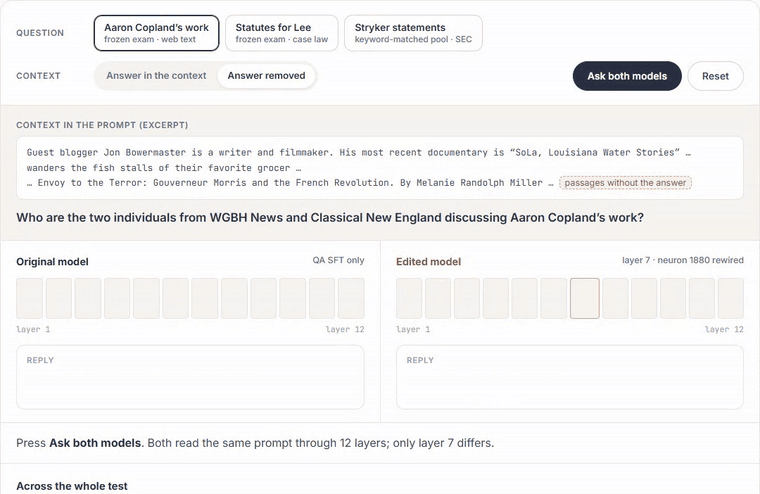

# Teaching a model to say "not stated" by writing its weights

**Live page:** [harman-weight-programming.vercel.app](https://harman-weight-programming.vercel.app) ·
**Final report:** [`docs/20_FINAL_REPORT.md`](docs/20_FINAL_REPORT.md) ·
**Index of every report:** [`docs/00_README.md`](docs/00_README.md)

Can I give a trained model a new habit by writing a few of its numbers directly, instead of training
it again? I tried it on my own 125M legal question-answering model. The habit: replying
"not stated in the context" when the context in the prompt doesn't hold the answer.



## The model I started from

`slm-125m-sft` (θ_qa): a 125.8M LLaMA-style model, pretrained from scratch, then given QA supervised
fine-tuning only. No RAG, no RAFT, no DPO, no RLAIF. There is no retrieval step: each question comes
with its context written into the prompt.

**The flaw:** on the 500 questions of the frozen exam whose answer is not in the context, it said
"not stated" 0 times. It answered every one of them anyway.

## The study in four results

| | Result |
|---|---|
| **It learns to say "not stated."** | 0% → 72.4% on the exam's missing-answer questions (362 of 500), from 3 vectors in 1 neuron. |
| **It forgets almost nothing.** | +0.011% worse on held-out text, against +5.86% for full fine-tuning and +8.87% for LoRA. |
| **It mostly reads keywords.** | With word overlap matched, its signal drops from 0.72 to 0.12. |
| **Hybrids pass. So does chance.** | AI editors found edits that clear every guardrail, and so did one random search over the same menu. |

## How the edit works: one neuron, two eyes and a hand

Neuron 1880 in layer 7 (block index 6) is rewired. Nothing else in the model changes.

```
activation = SiLU(gate · x̂) × (up · x̂)
output    += activation × down
```

x̂ is the input to layer 7's MLP (768 numbers). If either factor is near zero, the neuron writes
almost nothing, so it acts as an AND.

| Tensor slice | Job | Numbers |
|---|---|---|
| `model.layers.6.mlp.gate_proj[1880, :]` | eye 1: does the answer look missing? | 768 |
| `model.layers.6.mlp.up_proj[1880, :]` | eye 2: is the reply starting? | 768 |
| `model.layers.6.mlp.down_proj[:, 1880]` | hand: push toward "not stated in the context" | 768 |
| **Total**, out of 125.8 million | | **2,304** |

1. **Pick the neuron** (docs/12). A rule written in advance: the neuron with the smallest mean
   |activation| × ‖down column‖ over generic prompt positions in `edit_dev`. In block 6 that is 1880.
2. **Eye 1** (docs/12). A logistic absence probe w on x̂. Gate row = S · (w − τ·c), selected τ = 0.
3. **Eye 2** (docs/13). In version 1 this row was a constant and the neuron misfired inside ordinary
   text (SEC forgetting +1.72%). Now it is a weighted ridge detector that reads 1 at the reply start
   and 0 elsewhere. Misfires on raw text fell from 1.14% to 0.02%.
4. **The hand** (docs/12). With the model frozen, projected Adam (300 steps, batch 16) finds a vector
   δ that maximises log P("not stated in the context") at the last prompt token, with its norm capped.
   Down column = δ / m.
5. **The tests decide.** A safety gate (≤ 25% change per tensor, ≤ 5% overall, activations at most
   2× larger, check-text loss at most +10%), a 12-configuration grid on the dev fold, 3,378
   missing-answer and 3,378 answerable held-out questions against the guardrails, then the frozen exam.

## Gate by gate

Each stop had a written plan and a pass rule before it ran (Part A of each report), and every
prediction that failed is recorded as failed.

| Stop | Report | What happened | Verdict |
|---|---|---|---|
| Baseline | docs/06 | Published clean scores reproduced; the model says "not stated" 0 of 500 times. | reproduced |
| LoRA | docs/07 | Abstention +95.4% held out, but ordinary text up to 8.87% harder. | over the forgetting budget |
| Read the output | docs/09 | No lean toward "not stated" in the output: AUROC 0.42. | no signal |
| Read the inside | docs/10 | A probe on hidden states separates missing from present (layer-5 AUROC about 0.95). | present |
| Rank-1 edit | docs/11 | +0.19 abstention; failed clean F1, fabrication and SEC forgetting. | negative |
| One neuron | docs/12 | +0.726 abstention on the dev fold, but SEC forgetting +1.72%. | SEC forgetting |
| AND-gate | docs/13 | Second eye added: +0.737 held out, forgetting at most +0.011%. | passes held out |
| Overlap pool | docs/14 | With overlap matched, the signal falls from 0.72 to 0.12. | overlap-dominated |
| Full fine-tune | docs/15 | +0.96 abstention and +5.86% forgetting. | over the forgetting budget |
| AI editors | docs/16 | Three Claude agents, a budget of 18 evaluations each, all beat the hand-built grid. | 3 of 3 beat it |
| Random search | docs/17 | A random picker over the same menu also beat the grid on its first run. | menu suffices |
| Recursion | docs/18 | A second neuron: +0.868 abstention, but clean F1 missed the bar by 0.002. | degrades |
| Final exam | docs/19 | The pure edit misses clean F1 by 0.010; the hybrids pass; gains transfer at 97–107%. | hybrids pass |

## The evidence

### 01 · It learns to say "not stated"

Frozen exam, paired against θ_qa:

| Arm | What changes | "Not stated" on missing answers | Clean F1 Δ | Forgetting (held out) | Inside every guardrail |
|---|---|---|---|---|---|
| AND-gate edit | 1 neuron, 3 vectors | +0.724 | −0.018 [−0.030, −0.005] | +0.011% | no (clean F1, by 0.010) |
| LoRA lr 3e-4 | rank-16 adapters, every layer | +0.922 | +0.069 | +8.87% | no (forgetting) |
| Full fine-tune lr 1e-5 | every tensor | +0.932 | +0.068 | +5.86% | no (forgetting) |
| AI editors A / B / C | gate + slice of a fine-tune change | +0.91 / +0.87 / +0.87 | +0.00 / +0.06 / +0.01 | +0.35 / +0.33 / +0.43% | yes |
| Random search R1 | gate + slice of a fine-tune change | +0.804 | +0.023 | +0.40% | yes |

LoRA's +8.87% is its worst case on the fast held-out subset; on the full held-out set it is +8.78%
(docs/07). Forgetting and copy were measured on held-out text, not on the exam.

The habit transferred to the untouched exam almost exactly: +72.4% there against +73.7% held out.
The cost: the edit also says "not stated" on 4.6% of clean exam questions, where the answer is in the
context.

### 02 · It forgets almost nothing

Forgetting is the relative increase in next-token loss on held-out SEC filings, case law and web text.
The edit's worst set is +0.011%, inside the +0.5% budget. Full fine-tuning (+5.86%) and LoRA (+8.87%)
are both over it: 500–800 times more forgetting. The fine-tuning runs tried two learning rates each (docs/07,
docs/15); none was tuned specifically to stay inside the forgetting budget.

### 03 · It mostly reads keywords

On a pool where "answer missing" and "answer present" contexts share the same amount of wording with
the question, the edit's discrimination falls from 0.72 to 0.12. When the right passage is kept and
only the answer sentence is deleted, it says "not stated" on just 9–12%. The model's own signal for
"answer present" beyond overlap is weak: a probe reaches AUROC 0.64.

### 04 · Hybrids pass. So does chance

Three AI editors (Claude agents) had a menu of two move types: my gate (`and_gate`) and scaled slices
of the fine-tuning changes (`scaled_delta`). All three found edits inside every guardrail. One random
search over the same menu did too. The bigger menu did the work, not the editor's judgement. With one
random run, whether the editors beat chance by a little is still open.

### 05 · Doing it twice helps, then the rule says stop

The same recipe, run again at a fresh layer (block 7) on the edited model's remaining failures:
held-out abstention 73.7% → 86.8%, but false refusals 3.5% → 10.8%, and the clean-F1 lower bound hit
−0.022 against the −0.020 bar. The pre-registered stop rule ended the recursion there.

## What I learned

- **Constructed edits can be clean.** Three vectors installed 72.4% exam abstention with at most
  +0.011% forgetting.
- **Check what the detector reads.** The overlap-matched pool turned "it detects missing answers" into
  "it mostly detects missing keywords".
- **The menu mattered, not the editor.** One uninformed random-search run over the same options also
  beat the hand-built grid.
- **The measuring setup held.** Every arm's exam gain was 97–107% of its held-out gain, and the ranking
  of arms held (Kendall τ 0.90).

## Limits (from docs/20)

- **One model, one behaviour.** Abstention is a fixed phrase, a favourable case for constructed edits.
- **Small samples.** One random-search run, three editor runs, a single recursion iteration.
- **The editors were Claude-family agents** working from a written brief. Results may differ for other
  editors or briefs.
- **The exam's missing-answer condition always has 2 context passages.** No arm was selected on that
  shortcut, but the exam still carries it.
- **Retention and copy were measured on held-out text,** not on the exam.
- **Costs that were not targeted.** False abstention rose in every arm (+0.06 to +0.16 on the exam),
  and closed-book F1 fell by 0.05–0.11.

## Layout

| Path | Contents |
|---|---|
| `docs/` | Pre-registrations and results (Part A and Part B of each gate), final report, figures |
| `src/wsp/` | All study code: harness, edit engine, safety gate, every experiment |
| `wsp_runs/` | Result files only (`*_numbers.json`, tables, selections). Weights, deltas and per-item generations are not published (size); the items shown on the study page are in `docs/site_examples.json`. |
| `story-site/` | The study page deployed at the live link |
| `site/` | The earlier playground page |
| `splits/` | Split manifests (rules, counts, hashes) |
| `vendor/` | Read-only copies of the code this study builds on (see `PROVENANCE.md`) |

**Not in the repo, because of size:** `data/` (the exam, training data and retention sets) and
`checkpoints/`. The models are on the Hugging Face Hub:
[`Ace-2504/slm-125m-sft`](https://huggingface.co/Ace-2504/slm-125m-sft) (θ_qa) and
[`Ace-2504/slm-125m-e4`](https://huggingface.co/Ace-2504/slm-125m-e4).

## Ground rules followed

- The original checkpoints were hash-locked and never modified. Every arm is a separate delta file.
- Reported rates and paired deltas carry bootstrap 95% CIs in the reports.
- No editing decision used the final exam.
